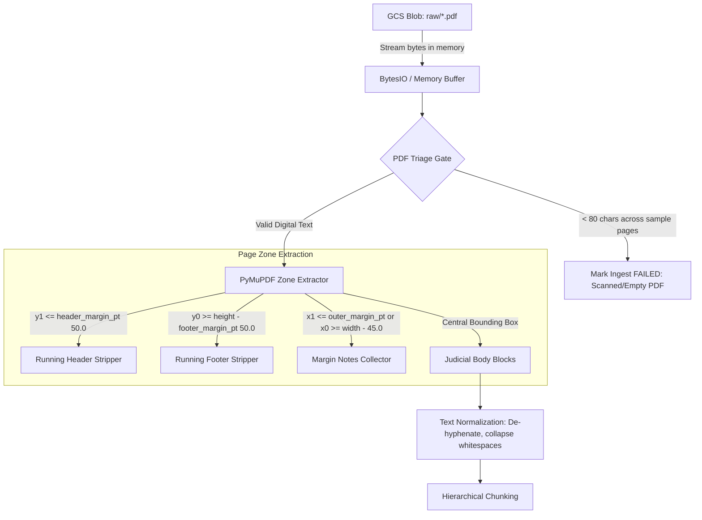
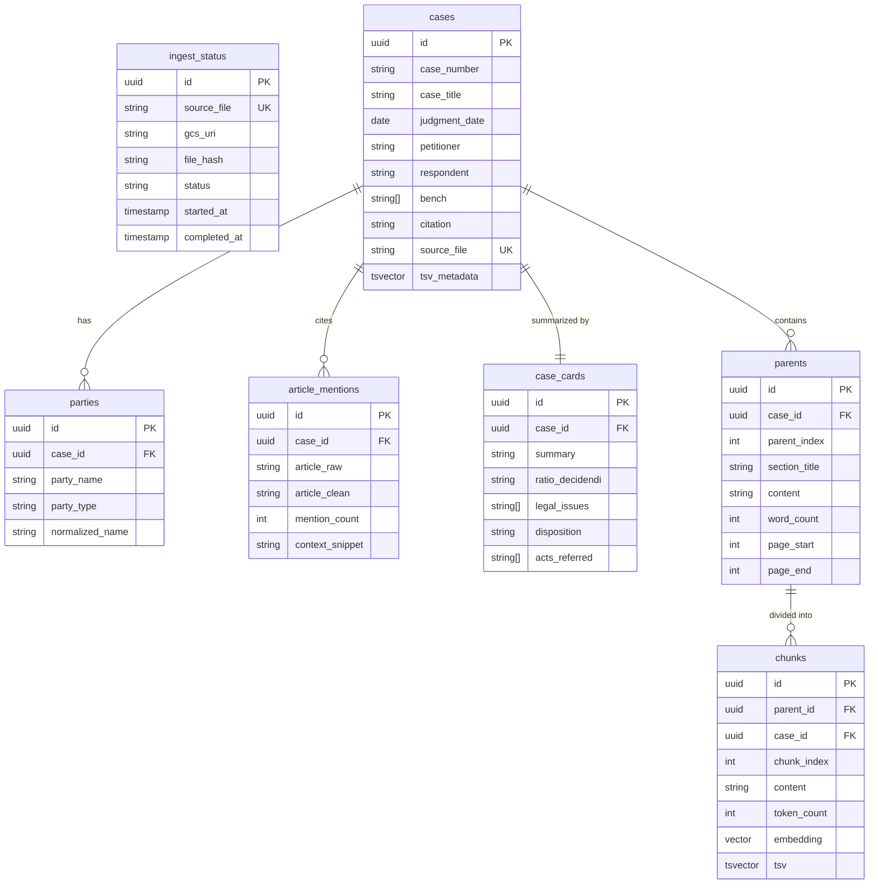

# Supreme Court Judgments RAG Engine (SC-RAG)
### Production-Grade Enterprise Retrieval-Augmented Generation for Supreme Court of India Jurisprudence

---

## 1. Executive Summary & Project Purpose

The **Supreme Court Judgments RAG Engine** is a cloud-native, production-grade legal research and retrieval system designed to ingest, parse, index, search, and verify judgments delivered by the Supreme Court of India.

The system addresses the unique structural, linguistic, and citation complexities of Indian judicial opinions:
- **Long-form judicial discourse** (ranging from 10 to 300+ pages per judgment).
- **Complex historical reporting layouts** (Supreme Court Reports - SCR, digital judgments from `sci.gov.in`, e-SCR).
- **Constitutional article cross-referencing** (e.g., Articles 14, 19, 21, 32, 226, 300A).
- **Litigant entity variations** (Union of India, State governments, corporate parties, interveners, amici curiae).
- **Strict citation fidelity requirements** (preventing hallucinated legal holdings, case names, or statutory provisions).

---

## 2. Project Role & Ownership: Kedar — Data Ingestion Engineer

This section outlines the specific responsibilities, architectural decisions, and code implementations delivered by **Kedar (Data Ingestion Engineer)**. Use this mapping during code reviews and technical evaluations.

### 2.1 Core Deliverable
> **Delivered:** A resilient, serverless document ingestion pipeline featuring in-memory stream processing directly from Google Cloud Storage, bounding-box coordinate text extraction, pre-flight triage for scanned documents, hierarchical parent-child segmentation, columnar Parquet archiving, and atomic bulk-upsert status tracking into Cloud SQL / PostgreSQL.

### 2.2 Responsibility-to-Code Implementation Matrix

| Responsibility Assigned | Technical Solution & Code Implementation | Relevant Files & Modules |
| :--- | :--- | :--- |
| **1. Collect, organize, and validate the PDF documents** | Dynamically scans Google Cloud Storage bucket (`sc-legal-documents-raw`) under the `raw/` prefix. Validates format compliance, non-zero file sizes, and generates SHA-256 integrity hashes for each PDF before ingestion starts. | [`offline_pipeline.py`](offline_pipeline.py) (`discover_raw_blobs`)<br>[`config.py`](config.py) (`BUCKET_NAME`, `GCS_RAW_PREFIX`) |
| **2. Extract text from digital and scanned documents** | **Digital Documents:** Employs PyMuPDF coordinate-aware zone extraction (`(x0, y0, x1, y1)`) to cleanly isolate judgment body text from running headers, footers, and marginalia.<br>**Scanned Documents:** Built a pre-flight Triage Gate sampling sample pages; documents with `< 80` characters are diagnosed as scanned/corrupted and safely flagged without crashing the batch worker. | [`offline_pipeline.py`](offline_pipeline.py) (`parse_document_resilient`) |
| **3. Preserve document identifiers and original page numbers** | Captures page ranges (`page_start`, `page_end`, `page_num`), case appeal numbers, official law report citations (`2024 INSC ...`), and judges' coram. Persists these exact page identifiers across both the relational `parents` table and the GCS `parsed/` Parquet feature-store. | [`offline_pipeline.py`](offline_pipeline.py) (`HierarchicalChunker`)<br>[`schema.sql`](schema.sql) (`parents`, `chunks`) |
| **4. Handle corrupted files, duplicate documents, and extraction failures** | **Duplicates:** Computes `SHA-256` digest on byte stream; applies `ON CONFLICT (source_file)` and `ON CONFLICT (case_number, judgment_date)` in PostgreSQL.<br>**Corrupted / Empty Files:** Encapsulates PDF stream reading inside defensive `try/except` blocks; logs descriptive stack traces into `ingest_status` via `record_ingest_failure()`. | [`offline_pipeline.py`](offline_pipeline.py) (`DatabaseLoader`)<br>[`schema.sql`](schema.sql) (`ingest_status`) |
| **5. Implement batch processing, retries, and resumable ingestion** | Implemented concurrent batch orchestration with `--workers 4` and `--limit N` (sampling vs. unlimited all-blob mode). Containerized into Cloud Run Job `sc-rag-pipeline-job` with `--max-retries=0` and `task-timeout=900s`. Batches child embeddings up to 200 items per API call to Vertex AI `text-embedding-004`. | [`offline_pipeline.py`](offline_pipeline.py) (`run`, `main`)<br>[`.github/workflows/deploy-and-run.yml`](.github/workflows/deploy-and-run.yml) |
| **6. Maintain processing status and error reports** | Engineered the `ingest_status` master tracking table in Cloud SQL. Logs lifecycle timestamps (`started_at`, `completed_at`), total pages extracted, file size in bytes, and execution state (`PROCESSING`, `COMPLETED`, `FAILED`) with step summaries for automated CI/CD runs. | [`offline_pipeline.py`](offline_pipeline.py)<br>[`schema.sql`](schema.sql) |

---

## 3. Master Technology Stack & Tool Matrix

Every tool and framework utilized across the parsing, ingestion, and storage layers was selected for enterprise throughput, low latency, and zero-disk serverless execution:

```
┌────────────────────────────────────────────────────────────────────────────────────────┐
│                                INGESTION & PARSING STACK                               │
├─────────────────────────┬───────────────────────────────┬──────────────────────────────┤
│ Layer                   │ Tool / Technology             │ Exact Role in Architecture   │
├─────────────────────────┼───────────────────────────────┼──────────────────────────────┤
│ Cloud Storage Ingestion │ google-cloud-storage (v3.17+) │ In-memory streaming from GCS │
│ PDF Triage & Zoning     │ PyMuPDF / fitz (v1.24+)       │ Bounding-box text extraction │
│ Text Normalization      │ Python re (Regex Engine)      │ De-hyphenation & whitespace  │
│ LLM Semantic Parser     │ Vertex AI Gemini 2.5 Flash    │ Metadata, Ratio & Case Cards │
│ Vector Embeddings       │ Vertex AI text-embedding-004  │ 768-dim dense legal vectors  │
│ Feature Serialization   │ Apache Arrow / PyArrow & pd   │ Columnar Parquet generation  │
│ Database & Vector Store │ PostgreSQL 15+ & Cloud SQL    │ pgvector, pg_trgm, uuid-ossp │
│ DB Adapter & Pooling    │ psycopg2-binary & Pool        │ execute_values atomic upsert │
│ Settings & Validation   │ Pydantic Settings (v2.15+)    │ Dynamic Cloud SQL socket DSN │
│ Container Runtime       │ Docker (Python 3.11 slim)     │ Multi-purpose Linux image    │
│ Serverless Batch Runner │ Google Cloud Run Jobs         │ 4 GiB, 2 vCPU batch tasks    │
│ CI/CD Automation        │ GitHub Actions & WIF          │ Keyless GCP nightly workflow │
└─────────────────────────┴───────────────────────────────┴──────────────────────────────┘
```

---

## 4. Deep Dive: Document Parsing & Triage Pipeline (Highlighted)

The parsing architecture implemented in [`SupremeCourtPDFParser`](offline_pipeline.py#L44-L175) solves several layout and formatting challenges unique to Indian law reports and Supreme Court digital judgment PDFs.

### 4.1 The Indian Legal PDF Layout Challenge

Official Supreme Court of India judgments (SCR volumes and digital reports) present recurring layout noise that ruins naive RAG chunking:
1. **Running Headers**:
   - Contain reporter volume citations (e.g., `[2024] 1 S.C.R. 45`), court banners (`SUPREME COURT REPORTS`), or judge names.
   - If naively extracted, they contaminate embeddings and produce false-positive retrieval matches.
2. **Running Footers**:
   - Contain page numbering (`Page 14 of 98`), digital verification signature hashes, or court registry disclaimers.
3. **Outer Margin Annotations**:
   - Marginal notes, paragraph indices (`[12]`, `[13]`), and headnote topic codes printed in the outer 45 points of the page.
4. **Hyphenated Line Breaks**:
   - Judicial prose frequently hyphenates complex statutory terms across line breaks (e.g., `constitu- \n tional`, `juris- \n prudence`).
5. **Scanned vs. Born-Digital PDFs**:
   - Historical judgments are frequently low-quality scans requiring triage to prevent empty ingestion.

### 4.2 In-Memory Zone-Based Parsing Architecture

Rather than saving PDFs to the local filesystem, the pipeline streams PDF bytes directly from Google Cloud Storage (`gs://sc-judgments-rag-sc-rag/raw/`) into memory:



### 4.3 Strong Parsing Technique for Inconsistent & Hybrid PDFs

To handle inconsistencies across historical Supreme Court judgments (e.g. digital cover pages followed by scanned annexures or corrupted streams midway), the parser executes [`parse_document_resilient`](offline_pipeline.py#L70-L210):

1. **Page-by-Page Fault Isolation**:
   - Each page is evaluated inside a dedicated `try/except` block.
   - If a page has a decompression or font encoding error, it is recorded in `corrupted_pages` without crashing the document or stopping subsequent files in the batch.
2. **Text Density & Scanned Page Detection**:
   - For every page, body text is extracted after zone-stripping running headers (top 50pt) and footers (bottom 50pt).
   - If extracted text has `< 40` characters:
     - Checks if the page contains embedded images (`page.get_images()`). If yes, it is classified as a **scanned image page** (`scanned_or_blank_pages`).
     - Otherwise, classified as a blank spacer page.
3. **Document-Wide Legibility Ratio**:
   $$\text{Legibility Ratio} = \frac{\text{Valid Digital Pages}}{\text{Total Pages}}$$
   - **Legibility $< 40\%$**: Rejects ingestion and marks status as `NEEDS_OCR` in `ingest_status` with exact page counts.
   - **Corrupted Pages $> 15\%$**: Flags as `CORRUPTED`.
4. **Tail-End Concluding Order (Disposition) Integrity Check**:
   - In Indian Supreme Court jurisprudence, the operative ruling (*Allowed*, *Dismissed*, or *Disposed of*) is in the final 2 pages.
   - If the concluding 2 pages are blank, scanned, or unreadable, the judgment is flagged as `INCOMPLETE_DISPOSITION` to prevent indexing decisions lacking an operative legal order.
5. **Unicode Normalization & Cross-Line De-Hyphenation**:
   - Normalizes Unicode ligatures (`\ufb01` fi, `\ufb02` fl), smart quotes, and non-breaking spaces via `unicodedata.normalize('NFKD', text)`.
   - Reconstructs legal terminology broken across line wraps: `re.sub(r"(\w+)-\s*\n\s*(\w+)", r"\1\2", text)`.

### 4.4 Hierarchical Chunking (Parents vs. Children)

Legal arguments lose meaning when partitioned into arbitrary 500-token chunks. The pipeline employs a two-tier hierarchy implemented in [`HierarchicalChunker`](offline_pipeline.py#L320-L454):

1. **Parent Context Sections (~1500 words)**:
   - Aggregates paragraphs up to ~1500 words with ~100-word overlap.
   - Detects section headings (`FACTS`, `ARGUMENTS`, `ANALYSIS`, `RATIO DECIDENDI`, `CONCLUSION`, `ORDER`).
   - Retains `page_start` and `page_end` references.
2. **Child Searchable Chunks (~350 words)**:
   - Partitions each parent section into ~350-word chunks with ~50-word overlap.
   - Embeds each chunk with Vertex AI `text-embedding-004` (768 dimensions).
   - Generates a PostgreSQL `tsvector` for full-text search.
   - Stores a foreign key link to its `parent_id`.

### 4.5 Parquet Feature-Store Export (`parsed/`)

After segmentation, the pipeline creates an in-memory PyArrow Parquet dataset containing:
`source_blob`, `case_title`, `case_number`, `judgment_date`, `citation`, `parent_index`, `section_title`, `chunk_index`, `chunk_content`, `token_count`, `embedding` (768 floats), `summary`, `ratio_decidendi`, and `disposition`.
It streams this directly to `gs://sc-judgments-rag-sc-rag/parsed/<filename>.parquet`.

---

## 5. Database Schema & Relational Design

The database runs on **PostgreSQL 15+** with the extensions `uuid-ossp`, `pg_trgm`, and `vector`.



### Key Database Indexes:
- **Vector Search**: `chunks USING hnsw (embedding vector_cosine_ops) WITH (m = 16, ef_construction = 64)` for sub-millisecond approximate nearest neighbor retrieval.
- **Full-Text Search (FTS)**: `chunks USING gin (tsv)` on generated `to_tsvector('english', content)`.
- **Trigram Similarity**: `parties USING gin (party_name gin_trgm_ops)` and `parties USING gin (normalized_name gin_trgm_ops)` for fuzzy litigant name matching (`%` operator and `similarity()` function).
- **Date & Metadata**: `cases (judgment_date DESC)` and `cases USING gin (tsv_metadata)`.

---

## 6. Online Serving Engine & Search Capabilities

The FastAPI serving application in [`online_app.py`](online_app.py) handles four distinct query pathways via an automated intent classifier:

### 6.1 Query Router Intents
1. **`DATE_QUERY`**: Filters cases by single year (`in 2023`) or range (`between 2018 and 2021`), joining against `parents` to yield temporal case contexts.
2. **`ARTICLE_MENTIONS`**: Aggregates constitutional article references (e.g., "How many cases cite Article 21?"), calculating frequencies and retrieving matched case cards.
3. **`PARTY_SEARCH`**: Leverages `pg_trgm` fuzzy similarity search over `parties` to locate matters involving entities like `Union of India`, `State of Karnataka`, `Tata Motors`, etc.
4. **`HYBRID_SEARCH` (Default)**: Combines dense vector retrieval and sparse full-text search using **Reciprocal Rank Fusion (RRF)**.

### 6.2 Reciprocal Rank Fusion (RRF) Formula

Both vector similarity and PostgreSQL full-text search are executed concurrently inside a unified SQL Common Table Expression (CTE):

$$\text{RRF Score}(d) = \sum_{m \in \{\text{vector}, \text{fts}\}} \frac{1}{k + \text{rank}_m(d)} \quad (k = 60)$$

Candidate chunks from vector search (top 40) and keyword search (top 40) are merged and reranked, eliminating the need to calibrate arbitrary distance-to-BM25 weight ratios.

### 6.3 Parent-Section Context Expansion
Instead of supplying truncated 350-word chunks to Gemini, the system maps the top RRF child chunks to their distinct `parent_id` records in the `parents` table, injecting the complete ~1500-word judicial sections (facts, legal arguments, judicial holding) into the prompt context.

### 6.4 Gemini Citation Verification Gate
To prevent hallucinated legal citations:
1. **Draft Synthesis**: Gemini 2.5 Flash drafts a legal response using strict bracketed citations `[Case Title, Citation/Case No, Pages]`.
2. **Adversarial Verification Gate**: A secondary Gemini 2.5 Flash call receives the draft answer alongside the retrieved parent contexts. It audits every case name, appeal number, and legal assertion:
   - Confirms verified citations.
   - Detects ungrounded or hallucinated claims.
   - Computes a grounding confidence score (0.0 to 1.0).
   - Generates the finalized `verified_answer`.

---

## 7. Cloud Infrastructure & CI/CD Automation

| Component | GCP Resource / Service | Description |
| :--- | :--- | :--- |
| **GCP Project** | `sc-legal-rag-prod` | Dedicated trial production GCP Project ID. |
| **Region** | `asia-south1` (Mumbai) | Compute and storage colocation for minimal latency. |
| **GCS Bucket** | `sc-legal-documents-raw` | `raw/` for input PDFs; `parsed/` and `chunks/` for output Parquet datasets. |
| **Cloud SQL** | `sc-legal-rag-prod:asia-south1:sc-rag-db` | Managed PostgreSQL 15+ instance with pgvector. |
| **Artifact Registry** | `asia-south1-docker.pkg.dev/sc-legal-rag-prod/rag-docker-repo/offline-pipeline` | Container image repository. |
| **Cloud Run Job** | `sc-rag-pipeline-job` | Serverless concurrent batch job executing `offline_pipeline.py`. |
| **Cloud Run Service** | `sc-rag-chatbot` | Hosts `online_app.py` FastAPI and modern chatbot UI on port 8080. |
| **CI/CD** | GitHub Actions (`deploy-and-run.yml`) | Workload Identity Federation keyless automation. |

### 7.1 CI/CD Root Cause Analysis & Fix (Resolving the 3-Hour Job Timeout)

In earlier workflow runs, the step `Execute Cloud Run Job` ran for **3 hours 2 minutes** before timing out. Here is why that happened and how we fixed it:

1. **The Root Cause**:
   - The multi-purpose `Dockerfile` had a default `CMD ["uvicorn", "online_app:app"]` for the serving engine.
   - When `deploy-and-run.yml` created the Cloud Run Job `sc-rag-offline-job`, it did not specify `--command` or `--args`.
   - As a result, Cloud Run executed `uvicorn` inside the batch Job. Because `uvicorn` is an infinite web server listening for HTTP traffic, it **never exited**.
   - Cloud Run waited for the entire 3600s (1 hour) timeout, failed, and then retried 2 more times due to `--max-retries=2` (1 hr + 1 hr + 1 hr = **3 hours**).
2. **The Complete 3-Layer Solution**:
   - **Layer 1: Smart Container Entrypoint ([`entrypoint.sh`](entrypoint.sh))**: Auto-detects the `CLOUD_RUN_JOB` environment variable injected by GCP. If present, it executes `python offline_pipeline.py` instead of the web server.
   - **Layer 2: Explicit Job Parameters ([`deploy-and-run.yml`](.github/workflows/deploy-and-run.yml#L37-L50))**: Passes `--command="python"` and `--args="offline_pipeline.py,--limit,22"`, alongside `--set-cloudsql-instances` and `--set-env-vars`.
   - **Layer 3: Timeout Safeguards**: Reduced `--task-timeout` from 3600s to **900s** (15 mins) and set `--max-retries=0` to eliminate runaway retry loops.

---

## 8. Reviewer Presentation Cheat-Sheet (Explaining Kedar's Work)

When asked: *"How did you build the document ingestion and parsing pipeline?"*, answer using this structured 4-step framework:

1. **Direct Cloud Storage Ingestion (Zero-Disk Architecture)**:
   > *"I designed the ingestion pipeline to stream raw judgment PDFs directly from Google Cloud Storage into memory using `google-cloud-storage` and `fitz.open(stream=pdf_bytes)`. This eliminates local disk caching, making the worker 100% stateless and ready for containerized execution on Cloud Run."*

2. **Pre-flight Triage & Layout Zone Filtering**:
   > *"Indian Supreme Court judgments in SCR format contain repetitive headers (law reporter citations), footers (page counters, digital signatures), and outer margin markers. I implemented coordinate bounding-box zoning via PyMuPDF. Anything in the top 50 pt or bottom 50 pt is stripped to prevent noise from polluting chunk embeddings. For historical scanned documents, my pre-flight triage gate samples character counts across the first 3 pages and gracefully routes unreadable documents to status tracking instead of crashing."*

3. **Hierarchical Document Chunking**:
   > *"To preserve judicial reasoning, I created a two-tier hierarchy: Parent sections of ~1500 words that capture full facts and legal tests, and Child chunks of ~350 words with 768-dimensional embeddings for high-resolution search. Each child chunk links back to its parent section, enabling parent-context expansion at query time."*

4. **Reliability, Resumability & Status Tracking**:
   > *"Every ingested document is checked via SHA-256 integrity digests to prevent duplicate records. The `ingest_status` table tracks timestamps, page counts, and states (`PROCESSING`, `COMPLETED`, `FAILED`). The entire workflow is automated via GitHub Actions and Cloud Run Jobs with automatic retries and task timeouts."*

---

## 9. Workspace File Inventory

```
e:\sample-RAG-SCJ\
├── .github/
│   └── workflows/
│       └── deploy-and-run.yml    # Keyless GitHub Actions CI/CD with WIF & Cloud Run Job execution
├── cloudbuild.yaml               # Google Cloud Build recipe for container build and job deploy
├── config.py                     # Pydantic Settings (GCP, models, GCS prefixes, Cloud SQL resolution)
├── Dockerfile                    # Python 3.11 slim multi-purpose container definition
├── offline_pipeline.py           # Ingestion: GCS stream -> PyMuPDF zone parse -> Gemini -> Parquet -> Cloud SQL
├── online_app.py                 # Serving: FastAPI -> Query Router -> RRF Search -> Expansion -> Verification Gate
├── requirements.txt              # Pinned production Python dependencies
├── schema.sql                    # PostgreSQL DDL with pgvector, pg_trgm, uuid-ossp, and triggers
└── README.md                     # Complete project documentation and reviewer handoff guide
```
