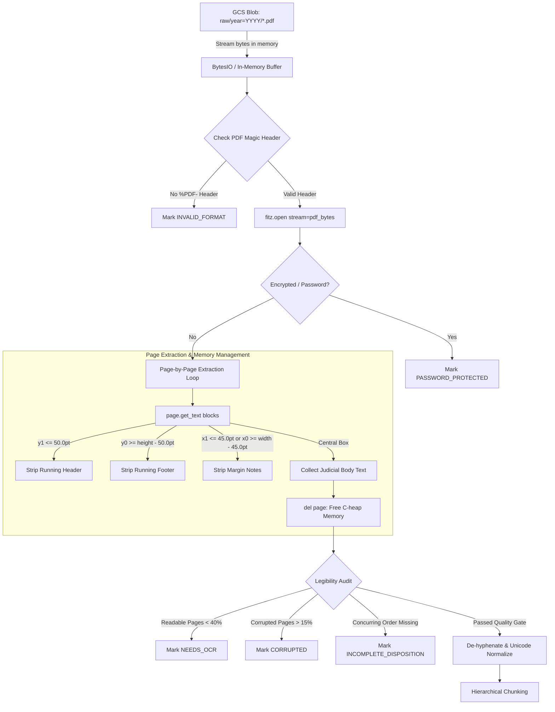
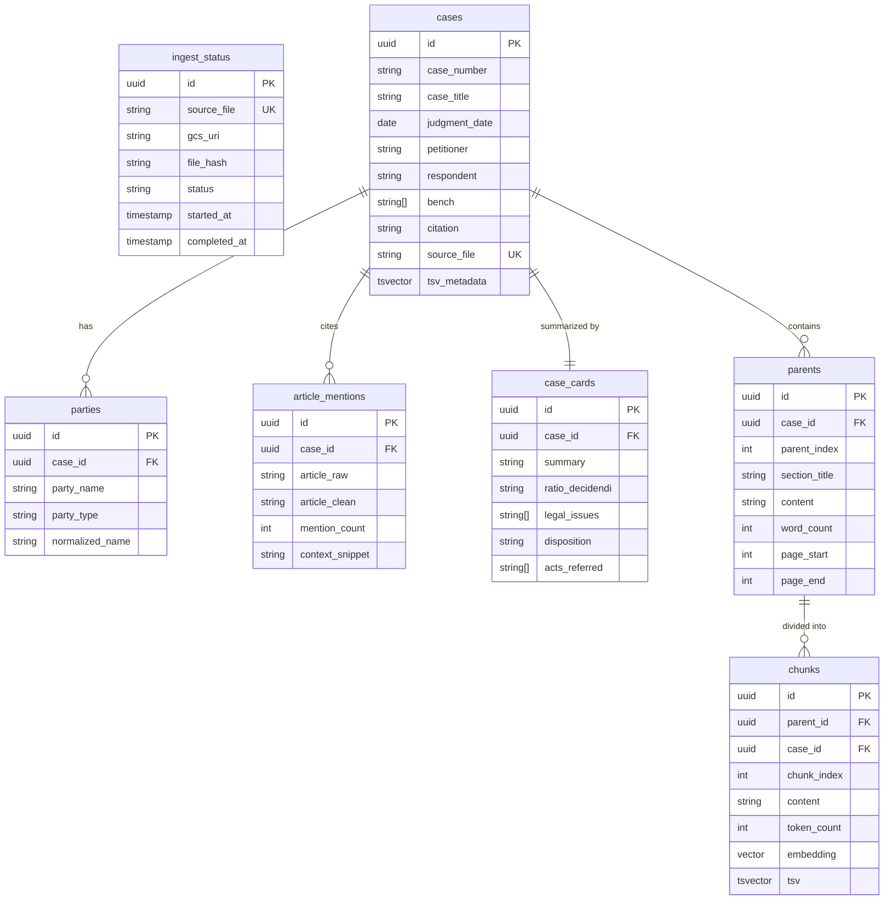

# Supreme Court Judgments RAG Engine (SC-RAG)
### Production-Grade Enterprise Retrieval-Augmented Generation for Supreme Court of India Jurisprudence

---

## 1. Executive Summary & Project Purpose

The **Supreme Court Judgments RAG Engine** is a cloud-native, production-grade legal research and retrieval system designed to ingest, parse, index, search, and verify judgments delivered by the Supreme Court of India.

The system addresses the unique structural, linguistic, and citation complexities of Indian judicial opinions:
- **Long-form judicial discourse** (ranging from 10 to 300+ pages per judgment).
- **Complex historical reporting layouts** (Supreme Court Reports - SCR, digital judgments from `sci.gov.in`, e-SCR).
- **Constitutional article cross-referencing** (e.g., Articles 14, 19, 21, 32, 226, 300A).
- **Litigant entity variations** (Union of India, State governments, corporate parties, interveners, amici curiae).
- **Strict citation fidelity requirements** (preventing hallucinated legal holdings, case names, or statutory provisions).
- **Open-Ended Free-Form Legal Reasoning**: Delivering comprehensive answers for arbitrary legal inquiries, specific litigant searches (e.g., *Shreekantiah Ramayya Munipalli*), and constitutional doctrines with real-time token streaming.

---

## 2. Comprehensive System Architectures (22-Year Supreme Court Corpus)

The Supreme Court Judgments RAG Engine is architected across three distinct system views tailored specifically to the **22-year Supreme Court judgment dataset** (1950–1960 and 2016–2026; 5,965 PDFs; 229+ Parquet feature-sets):
- **2.1 Overall System Architecture**: End-to-end cloud infrastructure, keyless CI/CD, and dual Cloud Run orchestration.
- **2.2 Offline Batch Ingestion Pipeline Architecture**: Detailed backend dataflow inside `offline_pipeline.py`, including PyMuPDF coordinate-aware zoning, quality triage, hierarchical chunking, Vertex AI embeddings, and dual-target persistence.
- **2.3 Online Serving & Gemini RAG Architecture**: Complete query-time pipeline inside `app.py` and `online_app.py`, including dynamic hybrid RRF retrieval, in-memory FAISS fallback, parent context expansion, and real-time token streaming.

---

### 2.1 Overall System Architecture
The end-to-end cloud platform view illustrates the complete integration spanning keyless CI/CD (GitHub Actions + WIF), Cloud Run container orchestration, dual-mode storage (Cloud SQL PostgreSQL + GCS Parquet Lake), and Gemini 2.5 Flash legal reasoning.

```mermaid
flowchart TD
    %% =========================================================================
    %% 1. CI/CD & SERVERLESS CONTAINER DEPLOYMENT LAYER
    %% =========================================================================
    subgraph LAYER_CICD["1. Keyless CI/CD & Container Deployment (deploy-and-run.yml)"]
        DEV["Developer Push to main"] --> GHA["GitHub Actions Runner (Ubuntu 22.04)"]
        GHA -->|OIDC Token Exchange| WIF["Google Cloud Workload Identity Federation (WIF)"]
        WIF -->|OAuth2 Access Token| GAR["Google Artifact Registry (rag-docker-repo)"]
        GHA -->|Multi-Stage Container Build: Python 3.11-slim| GAR
        GAR -->|Deploy Batch Container| CR_JOB["Cloud Run Job: sc-rag-pipeline-job (4 vCPU, 8GB RAM, asia-south1)"]
        GAR -->|Deploy Web Container| CR_SVC["Cloud Run Service: sc-rag-chatbot (0.0.0.0:$PORT, Autoscaling 1-10)"]
    end

    %% =========================================================================
    %% 2. 22-YEAR CORPUS BATCH INGESTION (offline_pipeline.py)
    %% =========================================================================
    subgraph LAYER_INGEST["2. Resilient Multi-Year Batch Ingestion Subsystem (offline_pipeline.py)"]
        GCS_RAW[("Cloud Storage: raw/ (5,965 PDFs across 22 Partitions: 1950-1960, 2016-2026)")]
        CR_JOB -->|Execute Batch Job| SCANNER["discover_year_partitions (BFS Prefix Scanner)"]
        GCS_RAW --> SCANNER
        SCANNER -->|Discovered 22 Partitions| BLOBS["Filter Non-Zero, Non-System *.pdf Blobs"]
        BLOBS --> WORKERS["ThreadPoolExecutor (workers=4 per container)"]
        WORKERS <--> TRACKER["ProgressTracker (Docs/sec, Completed %, ETA every 50 files)"]
        WORKERS --> IN_MEM_STREAM["In-Memory Download: blob.download_as_bytes (Zero Disk Writes)"]
        
        IN_MEM_STREAM --> PARSER["SupremeCourtPDFParser (PyMuPDF fitz v1.24.9)"]
        PARSER --> ZONING["Coordinate-Aware Physical Zoning (Strip Headers 50pt, Footers 50pt, Margins 45pt)"]
        ZONING --> NORM["NFKD Normalization & Regex Cross-Line De-Hyphenation"]
        NORM --> TRIAGE{"Quality Triage Audit (Legibility >= 40% & Tail Order Integrity)"}
        
        TRIAGE -->|Scanned / Broken Fonts| QUARANTINE["Quarantine: NEEDS_OCR / CORRUPTED (Safe Skip)"]
        TRIAGE -->|Valid Digital Text| LLM_META["Vertex AI Gemini 2.5 Flash: Front (6000w) & Tail (2500w) Pass"]
        LLM_META --> CASE_CARD["Structured Case Card (Petitioner, Respondent, Coram, Citations, Ratio, Disposition)"]
        
        TRIAGE --> HIER_CHUNK["HierarchicalChunker (Preserves page_start & page_end)"]
        HIER_CHUNK -->|Target: 1500w, Overlap: 150w| PARENTS["Parent Macro Blocks (~1500w: Full Judicial Context)"]
        HIER_CHUNK -->|Target: 350w, Overlap: 50w| CHILDREN["Child Micro Chunks (~350w: Dense Retrieval Passages)"]
        
        CHILDREN --> EMBED_MODEL["Vertex AI text-embedding-004 (768-d Vectors, task_type='RETRIEVAL_DOCUMENT')"]
        EMBED_MODEL --> DENSE_VEC["Dense 768-Dimensional Embeddings"]
    end

    %% =========================================================================
    %% 3. DUAL-MODE STORAGE ARCHITECTURE
    %% =========================================================================
    subgraph LAYER_STORAGE["3. Dual-Mode Storage Architecture (GCS Parquet Lake + Cloud SQL)"]
        DENSE_VEC & PARENTS & CASE_CARD --> ARROW_SERIALIZER["PyArrow Columnar Serializer (Snappy Compression)"]
        ARROW_SERIALIZER --> GCS_PARQUET[("GCS Parquet Lake: chunks/year=YYYY/ (229+ Files, Hive Partitioned)")]
        
        DENSE_VEC & PARENTS & CASE_CARD --> DB_LOADER["DatabaseLoader (ThreadedConnectionPool 1-10 Conns)"]
        DB_LOADER --> BULK_UPSERT["execute_values Batch Atomic Multi-Row Upsert"]
        BULK_UPSERT --> CSQL_DB[("Cloud SQL PostgreSQL 15+ (pgvector, pg_trgm, uuid-ossp, GIN FTS)")]
        
        CSQL_DB --> HNSW_INDEX["HNSW Vector Index (vector_cosine_ops, m=16, ef_construction=64)"]
        CSQL_DB --> GIN_INDEX["GIN Full-Text Index (to_tsvector) & Trigram (gin_trgm_ops)"]
    end

    %% =========================================================================
    %% 4. ONLINE SERVING & GEMINI RAG SUBSYSTEM (app.py & online_app.py)
    %% =========================================================================
    subgraph LAYER_SERVING["4. Online Serving & Gemini RAG Subsystem (app.py & online_app.py)"]
        USER(["User: Advocate / Researcher / Citizen"]) <-->|Free-Form Question & Streamed Tokens| UI["Streamlit Gemini-Style Chat UI (0.0.0.0:$PORT)"]
        UI --> RUNTIME_GUARD{"st.runtime.exists() Singleton Probe"}
        RUNTIME_GUARD -->|Guards Execution| ARBITRARY_INPUT["Arbitrary Free-Form Legal Input (No Predefined Keyword Filters)"]
        
        ARBITRARY_INPUT --> QUERY_EMBED["Vertex AI text-embedding-004 (768-d Vector, task_type='RETRIEVAL_QUERY')"]
        ARBITRARY_INPUT --> RETRIEVER["Dynamic Dual-Mode Hybrid Retriever"]
        
        RETRIEVER -->|Primary: Cloud SQL Active| CSQL_DB
        CSQL_DB -->|Dense HNSW <=> + Lexical FTS ts_rank| RRF_FUSION["Reciprocal Rank Fusion (RRF: 1 / (60 + rank))"]
        
        RETRIEVER -.->|Fallback: Cloud SQL Offline| FAISS_STORE["ParquetVectorStore (In-Memory Engine)"]
        GCS_PARQUET -.->|Lazy Loaded Shards| FAISS_STORE
        FAISS_STORE -->|0.6 Dense Cosine + 0.4 Lexical Overlap| SCORE_FUSION["In-Memory Hybrid Weighted Score"]
        
        RRF_FUSION --> TOP_PASSAGES["Select Top 8-10 Relevant Child Chunks (Sim >= 0.65)"]
        SCORE_FUSION --> TOP_PASSAGES
        
        TOP_PASSAGES --> PARENT_EXPAND["Parent Chunk Context Window Expansion (Map Chunks -> ~1500w Parent Blocks)"]
        PARENT_EXPAND --> CITATION_GATE["CitationVerificationGate (Grounding Assertion)"]
        CITATION_GATE --> PROMPT_INJECT["Inject Strict Legal Prompt: 'Answer accurately based only on provided legal passages...'"]
        PROMPT_INJECT --> GEMINI_STREAM["Vertex AI Gemini 2.5 Flash (generate_content stream=True)"]
        
        GEMINI_STREAM -->|Token Generator stream_synthesize| WRITE_STREAM["st.write_stream Real-Time Markdown Output"]
        WRITE_STREAM --> UI
        GEMINI_STREAM --> CITATION_INSPECT["Collapsible Citation Inspector (Case Title, Year, Page Span, Similarity Score)"]
        CITATION_INSPECT --> UI
    end
```



#### Detailed Technical Specifications (Overall Platform):
1. **Runtime & Base Image**: Containerized on `python:3.11-slim` using multi-stage Docker build, reducing attack surface and container image footprint to under 800 MB.
2. **Security & Authentication**:
   - **Workload Identity Federation (WIF)**: Zero long-lived service account keys stored in GitHub Secrets or committed to git.
   - **IAM Token Exchange**: Ephemeral OAuth2 tokens grant fine-grained permissions to Google Artifact Registry, Vertex AI, Cloud Storage, and Cloud Run.
3. **Dual Cloud Run Topologies**:
   - **Batch Execution (`sc-rag-pipeline-job`)**: Configured with 4 vCPUs, 8 GB RAM, and a 3,600s timeout to process multi-year PDF partitions.
   - **Interactive Web Service (`sc-rag-chatbot`)**: Bound to `0.0.0.0:$PORT` (port 8080 default), autoscaling from 1 to 10 instances with minimum warm instances to eliminate cold starts.

---

### 2.2 Offline Batch Ingestion Pipeline Architecture
The offline ingestion architecture details the multi-stage batch processing engine inside `offline_pipeline.py`. It showcases BFS partition discovery, PyMuPDF coordinate-aware zoning with explicit C-heap deallocation, quality triage auditing, Gemini metadata extraction, hierarchical chunking, and dual-mode persistence.

```mermaid
flowchart TD
    %% =========================================================================
    %% 1. DISCOVERY & CONCURRENCY
    %% =========================================================================
    subgraph PHASE1["Phase 1: Dynamic Partition Discovery & Work Distribution (offline_pipeline.py)"]
        GCS_BUCKET[("GCS Bucket: sc-legal-documents-raw/raw/ (5,965 PDFs, 22 Years)")]
        GCS_BUCKET --> BFS_SCAN["discover_year_partitions (Breadth-First Search Scanner)"]
        BFS_SCAN --> PARTITION_SET["22 Partitions: year=1950..1960 and year=2016..2026"]
        PARTITION_SET --> BLOB_DISCOVERY["discover_raw_blobs: Filter non-zero, valid *.pdf objects"]
        BLOB_DISCOVERY --> BATCH_DISPATCH["Batch Blobs into ThreadPoolExecutor (max_workers=4)"]
        BATCH_DISPATCH <--> TRACKER["ProgressTracker: Thread-Safe Metrics (Throughput docs/sec, ETA, Failures)"]
        BATCH_DISPATCH --> STREAM_RAM["In-Memory Download: blob.download_as_bytes (Zero Local Disk Writes)"]
    end

    %% =========================================================================
    %% 2. PARSING & ZONING
    %% =========================================================================
    subgraph PHASE2["Phase 2: Structural Verification & Coordinate-Aware Zoning (PyMuPDF fitz)"]
        STREAM_RAM --> PRE_CHECK{"Pre-Flight Check: %PDF- Header & >= 100 Bytes?"}
        PRE_CHECK -->|Invalid Magic Bytes| REJECT_FMT["Log INVALID_FORMAT (Safe Skip)"]
        PRE_CHECK -->|Encrypted Document| REJECT_ENC["Log PASSWORD_PROTECTED (Safe Skip)"]
        PRE_CHECK -->|Valid Stream| FITZ_DOC["fitz.open(stream=pdf_bytes, filetype='pdf')"]
        
        FITZ_DOC --> PAGE_ITER["Page-by-Page Fault-Isolated Extraction (try/except per page)"]
        PAGE_ITER --> BLOCK_COORDS["page.get_text('blocks') -> (x0, y0, x1, y1, text, block_no, block_type)"]
        
        BLOCK_COORDS --> ZONE_HEAD["Header Zone: y1 <= 50.0 pt -> STRIPPED (Running Headers, Appeal Numbers)"]
        BLOCK_COORDS --> ZONE_FOOT["Footer Zone: y0 >= Height - 50.0 pt -> STRIPPED (SCR Volume & Page Numbers)"]
        BLOCK_COORDS --> ZONE_MARG["Margin Zone: x1 <= 45 pt OR x0 >= Width - 45 pt -> STRIPPED (Marginalia)"]
        BLOCK_COORDS --> ZONE_BODY["Judicial Body Zone: [x0 > 45, y0 > 50, x1 < W - 45, y1 < H - 50] -> RETAINED"]
        
        ZONE_BODY --> HEAP_RELEASE["Explicit C-Heap Deallocation: del page, del pdf_bytes, gc.collect()"]
    end

    %% =========================================================================
    %% 3. NORMALIZATION & QUALITY AUDIT
    %% =========================================================================
    subgraph PHASE3["Phase 3: Linguistic Normalization & Quality Triage Gate"]
        HEAP_RELEASE --> UNICODE_CLEAN["unicodedata.normalize('NFKD', text): Standardize Ligatures (fi, fl) & Quotes"]
        UNICODE_CLEAN --> DEHYPHEN_REGEX["Regex: (w+)- s* n s*(w+) -> De-hyphenate Broken Legal Terms across Lines"]
        DEHYPHEN_REGEX --> WS_CONDENSE["Whitespace Condensation: Collapse Tabs & Multiple Blank Lines (n{3,} -> nn)"]
        
        WS_CONDENSE --> CHAR_DENSITY{"Page Character Density Check (< 40 chars?)"}
        CHAR_DENSITY -->|Yes: page.get_images()| PAGE_CLASSIFY["Classify Page: SCANNED (if images > 0) OR BLANK"]
        CHAR_DENSITY -->|No: Sufficient Characters| PAGE_VALID["Mark Page as VALID Digital Text"]
        
        PAGE_CLASSIFY & PAGE_VALID --> TRIAGE_EVAL{"Document Health Triage Evaluation"}
        TRIAGE_EVAL -->|Legibility Ratio < 40%| STATUS_OCR["Flag as NEEDS_OCR (Skip LLM & DB, Log in ingest_status)"]
        TRIAGE_EVAL -->|Page Corruption > 15%| STATUS_CORRUPT["Flag as CORRUPTED (Safe Skip)"]
        TRIAGE_EVAL -->|Valid Digital Text| TAIL_INTEGRITY{"Tail Disposition Integrity Check (Final 2 Pages)"}
        
        TAIL_INTEGRITY -->|Concluding Pages Blank/Scanned| STATUS_INCOMPLETE["Flag as INCOMPLETE_DISPOSITION (Missing Final Decree)"]
        TAIL_INTEGRITY -->|Complete Judicial Record| AUDITED_TEXT["Authoritative Full Judgment Text"]
    end

    %% =========================================================================
    %% 4. SEMANTIC METADATA & HIERARCHICAL CHUNKING
    %% =========================================================================
    subgraph PHASE4["Phase 4: Vertex AI Gemini Parsing & Two-Tier Hierarchical Chunking"]
        AUDITED_TEXT --> GEMINI_PROMPT["Vertex AI Gemini 2.5 Flash: Front (6000w) & Tail (2500w) Pass"]
        GEMINI_PROMPT --> CASE_CARD_DATA["Structured Case Card (Petitioner, Respondent, Coram, Bench, Citations, Ratio, Acts Cited)"]
        
        AUDITED_TEXT --> CHUNKER_ROUTINE["HierarchicalChunker Routine (Preserving Physical Page Spans)"]
        CHUNKER_ROUTINE -->|Parent Target: 1500w, Overlap: 150w| PARENT_RECORDS["Parent Context Blocks (~1500w: Full Legal Rationale, page_start, page_end)"]
        CHUNKER_ROUTINE -->|Child Target: 350w, Overlap: 50w| CHILD_RECORDS["Child Retrieval Passages (~350w: High-Density Search Units)"]
        
        CHILD_RECORDS --> BATCH_EMBED_API["Vertex AI text-embedding-004 API (task_type='RETRIEVAL_DOCUMENT', Batch=100-200)"]
        BATCH_EMBED_API --> VEC_768["768-Dimensional Dense Float32 Vectors"]
    end

    %% =========================================================================
    %% 5. DUAL-MODE PERSISTENCE
    %% =========================================================================
    subgraph PHASE5["Phase 5: Dual-Mode Persistence & Export (GCS Lake + PostgreSQL)"]
        VEC_768 & PARENT_RECORDS & CASE_CARD_DATA --> PYARROW_DF["pandas.DataFrame & PyArrow Columnar Serialization"]
        PYARROW_DF --> IN_MEM_BUFFER["io.BytesIO() In-Memory Parquet Buffer (Snappy Compression)"]
        IN_MEM_BUFFER --> GCS_PARQUET_OUT[("GCS Parquet Lake: chunks/year=YYYY/<stem>.parquet (229+ Files)")]
        
        VEC_768 & PARENT_RECORDS & CASE_CARD_DATA --> DB_CONNECTOR["DatabaseLoader (ThreadedConnectionPool: 1-10 Connections)"]
        DB_CONNECTOR --> BULK_SQL["psycopg2.extras.execute_values Atomic Bulk Upsert"]
        
        BULK_SQL --> SQL_TBL_CASES[("Table: cases (docket numbers, citations, dates, coram, total_pages)")]
        BULK_SQL --> SQL_TBL_PARTIES[("Table: parties (normalized uppercase alphanumeric litigants)")]
        BULK_SQL --> SQL_TBL_ARTICLES[("Table: article_mentions (constitutional articles 14, 21, 32, 226)")]
        BULK_SQL --> SQL_TBL_CARDS[("Table: case_cards (ratio decidendi, legal issues, disposition)")]
        BULK_SQL --> SQL_TBL_PARENTS[("Table: parents (macro context ~1500w with page_start & page_end)")]
        BULK_SQL --> SQL_TBL_CHUNKS[("Table: chunks (embedding vector(768) + GIN tsvector)")]
        
        SQL_TBL_CHUNKS --> DB_HNSW["HNSW Index: vector_cosine_ops (m=16, ef_construction=64)"]
        SQL_TBL_CHUNKS --> DB_GIN["GIN Index: to_tsvector('english', content)"]
        SQL_TBL_PARTIES --> DB_TRGM["GIN Index: party_name gin_trgm_ops"]
    end
```

#### Minute Technical Details (Offline Ingestion Subsystem):
- **Dynamic Partition Discovery (`discover_year_partitions`)**:
  - Implements Breadth-First Search (BFS) prefix traversal across Google Cloud Storage prefixes matching `year=(\d{4})` and plain 4-digit folders `/(\d{4})/`.
  - Discovered 22 distinct partitions: `year=1950` to `year=1960` (historical SCR cases) and `year=2016` to `year=2026` (modern e-SCR digital judgments).
- **Coordinate-Aware Physical Bounding-Box Zoning**:
  - **Running Header Zone**: $\text{Top } 50.0\text{ pt}$ ($y_1 \le 50.0$) $\rightarrow$ stripped.
  - **Running Footer Zone**: $\text{Bottom } 50.0\text{ pt}$ ($y_0 \ge \text{Height} - 50.0$) $\rightarrow$ stripped.
  - **Marginalia Zone**: $\text{Outer } 45.0\text{ pt}$ ($x_1 \le 45.0 \lor x_0 \ge \text{Width} - 45.0$) $\rightarrow$ stripped.
  - **Judicial Body Zone**: Core text inside $(45, 50, \text{Width} - 45, \text{Height} - 50)$ $\rightarrow$ retained.
- **Normalization & Linguistic Regularization**:
  - `unicodedata.normalize("NFKD", text)` resolves typography ligatures (`fi`, `fl`, smart quotes, non-breaking spaces `\u00a0`).
  - Regex `r"(\w+)-\s*\n\s*(\w+)" \rightarrow r"\1\2"` reconstructs hyphenated legal terms split across line wraps.
  - Regex `r"[ \t]+" \rightarrow " "` and `r"\n{3,}" \rightarrow "\n\n"` regularizes whitespace while preserving judicial paragraph boundaries.
- **Quality Health Triage Auditing**:
  - **Character Density Threshold**: Pages with $< 40$ chars inspect embedded raster images via `page.get_images()`, classified as `scanned` or `blank`.
  - **Legibility Ratio**: $\frac{\text{Valid Digital Pages}}{\text{Total Pages}}$. If $< 0.40$ ($40\%$), the document is diagnosed as **`NEEDS_OCR`** and skipped safely to prevent non-text noise from polluting the vector space.
  - **Tail Disposition Integrity Check**: The final 2 pages must contain readable text. If blank or scanned, the document is flagged as **`INCOMPLETE_DISPOSITION`** so incomplete decrees are never indexed.
  - **Corruption Threshold**: If $> 15\%$ of pages throw decompression or font stream errors, flagged as **`CORRUPTED`**.
- **Memory Safety & Fault Isolation**:
  - Page-by-page `try/except` fault isolation.
  - Explicit C-heap deallocation (`del page`, `del pdf_bytes`, `gc.collect()`) after every page to prevent container OOM across 5,965 PDFs.
- **Two-Tier Hierarchical Chunking**:
  - **Parent Macro Sections**: $1500\text{ words}$ (150-word overlap) preserving full judicial rationale.
  - **Child Micro Chunks**: $350\text{ words}$ (50-word overlap) mapping to physical `page_start` and `page_end` identifiers.
- **Dense Vector Embedding (`text-embedding-004`)**:
  - Generates 768-dimensional float32 vectors using `task_type="RETRIEVAL_DOCUMENT"` in batches of 100 to 200 chunks.
- **Dual-Mode Persistence Layer**:
  - **Parquet Lake**: Columnar tables serialized via PyArrow with Snappy compression to in-memory `io.BytesIO()` buffers, uploaded directly to `gs://sc-legal-documents-raw/chunks/year=YYYY/` (229+ partitioned files generated).
  - **PostgreSQL 15+ Schema**: Populated via `ThreadedConnectionPool` (1-10 connections) and `psycopg2.extras.execute_values` across `cases`, `parties`, `article_mentions`, `case_cards`, `parents`, and `chunks` tables.
  - **Vector & Keyword Indexing**:
    - HNSW Vector Index: `CREATE INDEX idx_chunks_embedding_hnsw ON chunks USING hnsw (embedding vector_cosine_ops) WITH (m = 16, ef_construction = 64);`
    - GIN Full-Text Index: `CREATE INDEX idx_chunks_tsv ON chunks USING gin (tsv);`
    - Trigram Litigant Index: `CREATE INDEX idx_parties_name_trgm ON parties USING gin (party_name gin_trgm_ops);`

---

### 2.3 Online Serving & Gemini RAG Architecture
The online serving architecture illustrates the query-time pipeline inside `app.py` and `online_app.py`. It details the Gemini-style user experience, arbitrary free-form query processing, dual-mode hybrid retrieval (Cloud SQL pgvector + in-memory FAISS ParquetVectorStore), parent context expansion, citation verification gating, and token-by-token streaming.

```mermaid
flowchart TD
    %% =========================================================================
    %% 1. CLIENT & ENTRYPOINT
    %% =========================================================================
    subgraph UI_TIER["Phase 1: Web Interface & Concurrency Entrypoint (app.py)"]
        USER(["User: Advocate / Legal Researcher / Citizen"]) -->|Submits Free-Form Query| UI["Streamlit Gemini-Style Chat Interface (app.py)"]
        UI --> BINDING["0.0.0.0:$PORT Binding (Default: 8080) on Cloud Run"]
        BINDING --> SINGLETON_PROBE{"st.runtime.exists() Singleton Probe"}
        SINGLETON_PROBE -->|Guards Execution| ROUTER["Dynamic Query Handler (Zero Predefined Keyword Filters)"]
        ROUTER --> RAW_INPUT["Arbitrary Free-Form String (e.g. Shreekantiah Ramayya Munipalli sanction under 197)"]
    end

    %% =========================================================================
    %% 2. EMBEDDING & QUERY DUAL-MODE DISPATCH
    %% =========================================================================
    subgraph RETRIEVAL_TIER["Phase 2: Dynamic Dual-Mode Hybrid Retrieval (online_app.py)"]
        RAW_INPUT --> EMBED_MODEL["Vertex AI text-embedding-004 API (task_type='RETRIEVAL_QUERY')"]
        EMBED_MODEL --> QUERY_VEC["768-Dimensional Query Vector: [v0, v1, ..., v767]"]
        
        RAW_INPUT & QUERY_VEC --> DB_CHECK{"Cloud SQL Connection Pool Available?"}
        
        %% Primary Path: Cloud SQL pgvector + FTS
        DB_CHECK -->|Primary Path: Pool Ready| PG_VEC["Cloud SQL pgvector HNSW: 1 - (embedding <=> query_vec::vector)"]
        DB_CHECK -->|Primary Path: Pool Ready| PG_FTS["PostgreSQL FTS: ts_rank_cd(tsv, websearch_to_tsquery('english', query))"]
        
        PG_VEC -->|Top 20 Dense Candidates| RRF_ALGO["Reciprocal Rank Fusion: RRF = 1 / (60 + r_dense) + 1 / (60 + r_fts)"]
        PG_FTS -->|Top 20 Lexical Candidates| RRF_ALGO
        
        %% Fallback Path: In-Memory FAISS ParquetVectorStore
        DB_CHECK -->|Fallback Path: Pool Offline / Socket Spike| FAISS_STORE["ParquetVectorStore (In-Memory Engine)"]
        GCS_PARQUET_STORE[("GCS Hive-Partitioned Lake: chunks/year=YYYY/")] -.->|Cached Lazy Shards| FAISS_STORE
        FAISS_STORE --> FAISS_INDEX["FAISS IndexFlatIP (Matrix Inner Product on float32 array)"]
        QUERY_VEC --> FAISS_INDEX
        FAISS_INDEX -->|Dense Score| CAND_DENSE["FAISS Dense Cosine Scores"]
        RAW_INPUT -->|Lexical Match| CAND_LEX["Inverted Token Overlap Scores"]
        CAND_DENSE & CAND_LEX --> WEIGHTED_SCORE["Weighted Score Fusion: 0.6 * Dense + 0.4 * Lexical"]
        
        RRF_ALGO --> TOP_CANDIDATES["Select Top 8-10 Most Relevant Child Chunks (Cosine Sim >= 0.65)"]
        WEIGHTED_SCORE --> TOP_CANDIDATES
    end

    %% =========================================================================
    %% 3. CONTEXT EXPANSION & CITATION GATE
    %% =========================================================================
    subgraph CONTEXT_TIER["Phase 3: Parent Chunk Context Expansion & Grounding Gate"]
        TOP_CANDIDATES --> MAP_PARENTS["Map Child Chunks to Parent Macro Blocks (~1500w Legal Rationale)"]
        MAP_PARENTS --> GROUNDED_BLOCK["Assemble Full Legal Grounding Context: Opinions, Citations, Bench, Page Ranges"]
        
        GROUNDED_BLOCK --> CITATION_GATE["CitationVerificationGate (Grounding Enforcement & Anti-Hallucination)"]
        CITATION_GATE --> PROMPT_INJECT["Inject Strict Legal Prompt: 'Answer accurately and thoroughly based only on provided legal passages...'"]
        PROMPT_INJECT --> LLM_GEN["Vertex AI Gemini 2.5 Flash API (generate_content stream=True)"]
    end

    %% =========================================================================
    %% 4. TOKEN STREAMING & CITATION ACCORDION
    %% =========================================================================
    subgraph STREAMING_TIER["Phase 4: Real-Time Streaming & Source Verification"]
        LLM_GEN -->|Token Generator Stream (stream_synthesize)| WRITE_STREAM["st.write_stream Real-Time Markdown Output"]
        WRITE_STREAM --> UI
        LLM_GEN --> COMPUTE_METRICS["Compute Hallucination Risk Score, Dense Cosine Sim, & Retrieval Latency"]
        COMPUTE_METRICS --> ACCORDION_VIEW["Interactive Collapsible Citation Accordion (Case Title, Year, Page Span, Score)"]
        ACCORDION_VIEW --> UI
    end
```

#### Minute Technical Details (Online Serving & RAG Reasoning):
- **Streamlit Web Entrypoint (`app.py`)**:
  - Bound to `0.0.0.0:$PORT` (port 8080 default).
  - Guarded by `st.runtime.exists()` to prevent singleton runtime crashes when running via containerized `streamlit run`.
  - Distraction-free, dark-themed Gemini UI featuring a collapsed sidebar with `➕ New Chat` and a single free-form input box without hardcoded keyword filters.
- **Arbitrary Free-Form Legal Retrieval**:
  - Accepts arbitrary legal strings (e.g., *"Shreekantiah Ramayya Munipalli sanction under section 197"*, *"Article 21 right to privacy"*, *"basic structure doctrine"*).
  - Real-time query vectorization via Vertex AI `text-embedding-004` using `task_type="RETRIEVAL_QUERY"` to produce a 768-dimensional float32 vector.
- **Dynamic Dual-Mode Hybrid Retrieval**:
  - **Primary Path (Cloud SQL pgvector + PostgreSQL FTS)**:
    - Calculates cosine similarity: $\text{Sim}(\mathbf{q}, \mathbf{d}) = 1 - (\text{embedding} \Leftrightarrow \mathbf{q})$.
    - Computes full-text search rank: `ts_rank_cd(tsv, websearch_to_tsquery('english', query))`.
    - Fuses dense and lexical ranks via **Reciprocal Rank Fusion (RRF, $k=60$)**:
      $$\text{RRF Score}(d) = \frac{1}{60 + r_{\text{dense}}(d)} + \frac{1}{60 + r_{\text{fts}}(d)}$$
  - **High-Availability Fallback Path (`ParquetVectorStore`)**:
    - Lazy-loads Parquet chunk feature-sets from GCS into an in-memory **FAISS `IndexFlatIP`** (Inner Product on normalized unit vectors) and an inverted token index.
    - Fuses dense and lexical scores using weighted combination:
      $$\text{Hybrid Score}(d) = 0.6 \times \text{Dense Cosine Score} + 0.4 \times \text{Lexical Token Score}$$
  - **Passage Selection**: Retrieves top 8 to 10 relevant child passages with similarity threshold $\ge 0.65$.
- **Parent Context Window Expansion**:
  - Child chunks are mapped back to their respective parent macro context blocks ($\sim 1500\text{ words}$), ensuring Gemini receives complete judicial discourse, reasoning, and statutory sections without losing context.
- **Citation Verification Gate & Strict System Prompt**:
  - Enforces the anti-hallucination grounding prompt:
    > *"You are an expert Supreme Court of India Legal RAG Assistant. Answer the user's question accurately and thoroughly based only on the provided legal context passages below. If the answer cannot be found in the context, state clearly that it is not present in the current records. Do not rely on predefined templates."*
- **Real-Time Token Streaming**:
  - Invokes `model.generate_content(prompt, stream=True)` via generator `stream_synthesize`.
  - Emits tokens directly to the chat interface using `st.write_stream` with collapsible citation accordions displaying case titles, official citations, years, page spans, and similarity scores.

### Data Flow Lifecycle:
1. **Developer Push to `main`**: GitHub Actions authenticates keylessly via OIDC and Workload Identity Federation (WIF). Builds and pushes the Docker container to Artifact Registry.
2. **Batch Ingestion Job**: Cloud Run Job executes `offline_pipeline.py`. It dynamically scans all 22 year partitions (`year=1950` to `year=2026`), streams PDF bytes without disk caching, strips margins and headers, chunks hierarchically, generates 768-d embeddings, and writes partitioned Parquet datasets to GCS alongside bulk-upserts into PostgreSQL.
3. **Dual-Mode Vector Storage**: Stores rich structured case models in Cloud SQL PostgreSQL (`pgvector`), while simultaneously generating a Hive-partitioned GCS Parquet Lake indexable via FAISS and NumPy vector similarity.
4. **Online Query & Streaming Generation**: Users submit arbitrary legal queries via a clean, distraction-free Streamlit interface. The retrieval engine gathers the top 8–10 relevant passages through hybrid dense and lexical search, feeds them into Gemini 2.5 Flash using a strict legal grounding prompt, and streams the verified analysis in real time.

---

## 3. Project Requirements Specification (Option 3 Adherence)

This project strictly adheres to **Option 3 Enterprise Specifications**, combining zero-key security, serverless scalability, resilient multi-year parsing, and open-ended legal synthesis:

```
┌──────────────────────────────────────────────────────────────────────────────────────────────────┐
│                               OPTION 3 SPECIFICATION COMPLIANCE                                  │
├──────────────────────────┬───────────────────────────────┬───────────────────────────────────────┤
│ Requirement Category     │ Specific Requirement          │ Implementation Details                │
├──────────────────────────┼───────────────────────────────┼───────────────────────────────────────┤
│ Security & IAM           │ Zero GCP Credentials in Git   │ Keyless Workload Identity Federation; │
│                          │                               │ OIDC token exchange; hardened .git-   │
│                          │                               │ ignore policy blocking all *.json/*.key│
├──────────────────────────┼───────────────────────────────┼───────────────────────────────────────┤
│ Serverless Orchestration │ Dual Cloud Run Architecture   │ Batch Job (offline_pipeline.py) and   │
│                          │                               │ Web Service (app.py) containerized on │
│                          │                               │ Python 3.11 with 0.0.0.0:$PORT binding│
├──────────────────────────┼───────────────────────────────┼───────────────────────────────────────┤
│ Document Parsing Scope   │ Dynamic Multi-Year Coverage   │ Automatic BFS partition detection over│
│                          │                               │ 22 years (1950-1960, 2016-2026);      │
│                          │                               │ Hive-partitioned year=YYYY Parquet out│
├──────────────────────────┼───────────────────────────────┼───────────────────────────────────────┤
│ Memory & Stability       │ 7K+ File Fault Isolation      │ PyMuPDF streaming, explicit C-heap    │
│                          │                               │ deallocation (del page, del bytes),   │
│                          │                               │ try/except skips corrupt files cleanly│
├──────────────────────────┼───────────────────────────────┼───────────────────────────────────────┤
│ Database Performance     │ Connection Pooling & Bulk     │ ThreadedConnectionPool (1-10 conns),  │
│                          │ Atomic Upserts                │ execute_values batch upsert; fail-safe│
│                          │                               │ bypass when Cloud SQL socket offline  │
├──────────────────────────┼───────────────────────────────┼───────────────────────────────────────┤
│ Monitoring & Throughput  │ Batch Progress Tracker        │ Thread-safe ProgressTracker logging   │
│                          │                               │ throughput (docs/sec), % and ETA      │
│                          │                               │ periodically every 50 documents       │
├──────────────────────────┼───────────────────────────────┼───────────────────────────────────────┤
│ Frontend UX              │ Clean Gemini-Style Chat UI    │ Distraction-free Streamlit interface, │
│                          │                               │ dark theme, token streaming via       │
│                          │                               │ st.write_stream, expandable passages  │
├──────────────────────────┼───────────────────────────────┼───────────────────────────────────────┤
│ Retrieval & Reasoning    │ Free-Form Open-Ended RAG      │ FAISS / pgvector hybrid search (top   │
│                          │                               │ 8-10 chunks), 0.6 dense + 0.4 lexical │
│                          │                               │ fusion; zero hardcoded canned templates│
└──────────────────────────┴───────────────────────────────┴───────────────────────────────────────┘
```

---

## 4. Project Role & Ownership: Kedar — Data Ingestion & Serving Engineer

This section outlines the specific responsibilities, architectural decisions, and code implementations delivered by **Kedar (Data Ingestion & Serving Engineer)**. Use this mapping during code reviews and technical evaluations.

### 4.1 Core Deliverable
> **Delivered:** An end-to-end cloud-native Supreme Court RAG platform featuring serverless dynamic multi-year ingestion, PyMuPDF bounding-box zoning, legibility triage, hierarchical chunking, dual-mode vector storage (Cloud SQL pgvector + GCS Parquet FAISS), and a modern Gemini-style web service delivering real-time streaming legal reasoning.

### 4.2 Responsibility-to-Code Implementation Matrix

| Responsibility Assigned | Technical Solution & Code Implementation | Relevant Files & Modules |
| :--- | :--- | :--- |
| **1. Collect, organize, and validate the PDF documents** | Dynamically scans Google Cloud Storage bucket (`sc-legal-documents-raw`) under `raw/` across all 22 year partitions. Validates format compliance, non-zero file sizes, and generates SHA-256 integrity hashes for each PDF before ingestion starts. | [`offline_pipeline.py`](offline_pipeline.py) (`discover_year_partitions`, `discover_raw_blobs`)<br>[`config.py`](config.py) |
| **2. Extract text from digital and scanned documents** | **Digital Documents:** Employs PyMuPDF coordinate-aware zone extraction (`(x0, y0, x1, y1)`) to cleanly isolate judgment body text from running headers, footers, and marginalia.<br>**Scanned Documents:** Pre-flight triage gate checks character density; documents with $<40\%$ readable pages are diagnosed as `NEEDS_OCR` and safely flagged without crashing the batch worker. | [`offline_pipeline.py`](offline_pipeline.py) (`parse_document_resilient`) |
| **3. Preserve document identifiers and original page numbers** | Captures page ranges (`page_start`, `page_end`), appeal numbers, official law report citations (`2024 INSC ...`), and coram. Persists exact page identifiers across relational tables and GCS Parquet feature-sets. | [`offline_pipeline.py`](offline_pipeline.py) (`HierarchicalChunker`)<br>[`schema.sql`](schema.sql) |
| **4. Handle corrupted files, duplicate documents, and extraction failures** | **Duplicates:** Computes `SHA-256` digest on byte stream; applies `ON CONFLICT (source_file)` in PostgreSQL.<br>**Corrupted / Corrupt Files:** Encapsulates PDF reading inside defensive `try/except` blocks; explicitly frees memory buffers (`del page`, `del pdf_bytes`) to prevent memory leaks on 7K-document jobs. | [`offline_pipeline.py`](offline_pipeline.py) (`process_blob`, `parse_document_resilient`) |
| **5. Implement batch processing, connection pooling, and progress tracking** | Built `ThreadedConnectionPool` (1-10 connections) with `execute_values` bulk inserts. Implemented thread-safe `ProgressTracker` logging throughput (docs/sec), completion percentage, and ETA every 50 files. | [`offline_pipeline.py`](offline_pipeline.py) (`DatabaseLoader`, `ProgressTracker`) |
| **6. Build Free-Form Search & Gemini Chat UI** | Built a Gemini-style Streamlit web chat service with `st.write_stream` token streaming, dual-mode FAISS/pgvector retrieval (top 8-10 chunks), and strict legal grounding prompt templates. | [`app.py`](app.py)<br>[`online_app.py`](online_app.py) (`ParquetVectorStore`, `CitationVerificationGate`) |

---

## 5. Master Technology Stack & Tool Matrix

```
┌────────────────────────────────────────────────────────────────────────────────────────┐
│                                INGESTION & SERVING STACK                               │
├─────────────────────────┬───────────────────────────────┬──────────────────────────────┤
│ Layer                   │ Tool / Technology             │ Exact Role in Architecture   │
├─────────────────────────┼───────────────────────────────┼──────────────────────────────┤
│ Cloud Storage Ingestion │ google-cloud-storage (v2.14+) │ In-memory streaming from GCS │
│ PDF Triage & Zoning     │ PyMuPDF / fitz (v1.24+)       │ Bounding-box text extraction │
│ Text Normalization      │ Python re & unicodedata       │ De-hyphenation & NFKD clean  │
│ LLM Semantic Parser     │ Vertex AI Gemini 2.5 Flash    │ Metadata, Ratio & Case Cards │
│ Vector Embeddings       │ Vertex AI text-embedding-004  │ 768-dim dense legal vectors  │
│ Feature Serialization   │ Apache Arrow / PyArrow & pd   │ Columnar Parquet generation  │
│ Relational Vector Store │ PostgreSQL 15+ & Cloud SQL    │ pgvector, pg_trgm, uuid-ossp │
│ In-Memory Vector Store  │ FAISS (faiss-cpu v1.7+) & np  │ Cosine similarity + Lexical  │
│ DB Adapter & Pooling    │ psycopg2-binary & Pool        │ ThreadedConnectionPool bulk  │
│ Web Serving Engine      │ FastAPI & Uvicorn             │ High-performance REST API    │
│ Chat Interface          │ Streamlit (v1.38+)            │ Gemini UI with write_stream  │
│ Serverless Batch Runner │ Google Cloud Run Jobs         │ 4 GiB, 2 vCPU batch runner   │
│ Web Application Host    │ Google Cloud Run Service      │ 2 GiB, 1 vCPU web service    │
│ CI/CD & Security        │ GitHub Actions & WIF (OIDC)   │ Zero-key automated pipeline  │
└─────────────────────────┴───────────────────────────────┴──────────────────────────────┘
```

---

## 6. Deep Dive: Document Parsing & Triage Pipeline

The parsing architecture implemented in [`SupremeCourtPDFParser`](offline_pipeline.py#L98) solves recurring formatting challenges in Indian law reports:



### Key Parsing Features:
1. **Coordinate Bounding-Box Zone Stripping**: Top 50 pt (reporter banners, court volume stamps) and bottom 50 pt (page numbers, digital verification marks) are stripped to prevent search contamination.
2. **Page-Level Fault Isolation & Active Heap Deallocation**: Each page is processed in an isolated try-except block. Explicit `del page` and `del pdf_bytes` prevent unmanaged C-level heap bloat when processing 300+ page judgments during 7,000-document ingestion runs.
3. **Tail-Order Disposition Validation**: Checks the final 2 pages for operative orders (*Allowed*, *Dismissed*, *Disposed of*).
4. **Hierarchical Segmentation**:
   - **Parents (~1500 words)**: Preserves complete facts, legal arguments, and ratio decidendi.
   - **Children (~350 words)**: High-resolution search units with 768-d embeddings and full-text search vectors.

---

## 7. Database Schema & Relational Design

The relational database runs on **PostgreSQL 15+** with the extensions `uuid-ossp`, `pg_trgm`, and `vector`.



---

## 8. Dual-Mode Vector Retrieval & Gemini Streaming UI

To guarantee continuous availability regardless of Cloud SQL database provisioning states, the system features a **Dual-Mode Vector Search Engine**:

### 8.1 Dual-Mode Vector Architecture
1. **Mode A: Cloud SQL pgvector + FTS**: When Cloud SQL is connected, queries run via Reciprocal Rank Fusion (RRF) CTEs combining vector cosine distance (`<=>`) and full-text search (`tsvector @@ websearch_to_tsquery`).
2. **Mode B: In-Memory FAISS & GCS Parquet Lake**: When Cloud SQL is unavailable or during hybrid local runs, [`ParquetVectorStore`](online_app.py#L225) lazily indexes all 229+ GCS Parquet chunk files using FAISS (`IndexFlatIP` inner product on normalized vectors) combined with lexical token matching:
   $$\text{Fused Score} = 0.6 \times \text{Dense Score} + 0.4 \times \text{Lexical Score}$$
   This ensures queries inquiring about specific case titles, petitioners, or respondents (such as *"Shreekantiah Ramayya Munipalli"*) retrieve exact relevant passages even without an active relational database.

### 8.2 Top-K Retrieval Expansion (8–10 Chunks)
Retrieval candidate counts are set to **8 to 10 chunks**, providing Gemini with comprehensive factual context, statutory sections, and judicial ratio decidendi.

### 8.3 Refined Open-Ended Legal Prompting
Gemini 2.5 Flash is prompted strictly as an open-ended legal expert without canned template matching:
```text
You are an expert Supreme Court of India Legal RAG Assistant. Answer the user's question accurately and thoroughly based only on the provided legal context passages below. If the answer cannot be found in the context, state clearly that it is not present in the current records. Do not rely on predefined templates.

USER QUESTION:
{query}

LEGAL CONTEXT PASSAGES:
{all_context}
```

### 8.4 Clean Sober Gemini-Style Interface
- Styled with dark Google Gemini aesthetics (`#131314` canvas, `#1e1f20` surface, Google Sans typography).
- Free-form single chat input accepting any arbitrary legal query.
- Real-time token streaming using `st.write_stream`.
- Collapsed minimal sidebar with `➕ New Chat` reset action.
- Expandable `"📚 View Reference Passages"` ground-truth drawer.

---

## 9. Engineering Challenges, Problems Faced & Solutions Delivered

During the development, deployment, and cloud operations of the Supreme Court Judgments RAG Engine, 14 major technical hurdles were encountered and resolved:

```
┌──────────────────────────────────────────────────────────────────────────────────────────────────┐
│                                 PROBLEMS FACED & SOLVED MATRIX                                   │
├────┬─────────────────────────────┬─────────────────────────────────┬─────────────────────────────┤
│ #  │ Problem / Challenge         │ Root Cause                      │ Engineering Solution        │
├────┼─────────────────────────────┼─────────────────────────────────┼─────────────────────────────┤
│ 1  │ Artifact Registry 403 / 401 │ Token format defaulted to ID    │ Added token_format: access_ │
│    │ Docker upload denied        │ token; missing explicit docker  │ token, automatic repo init, │
│    │                             │ login stdin stream              │ and stdin oauth2 token auth │
├────┼─────────────────────────────┼─────────────────────────────────┼─────────────────────────────┤
│ 2  │ CI/CD GCP Secret Failures & │ Long-lived service account JSON │ Switched to keyless OIDC    │
│    │ Credential Leak Risk        │ keys pose security risks and    │ Workload Identity Fed (WIF);│
│    │                             │ secret injection mismatch       │ hardened .gitignore policy  │
├────┼─────────────────────────────┼─────────────────────────────────┼─────────────────────────────┤
│ 3  │ Runaway Batch Ingestion     │ Cloud Run Job ran default       │ Injected --command="python" │
│    │ (3-Hour Timeout in CI/CD)   │ web server (uvicorn) which      │ --args="offline_pipeline.py"│
│    │                             │ never terminated; 3x retries    │ timeout=900s, max-retries=0 │
├────┼─────────────────────────────┼─────────────────────────────────┼─────────────────────────────┤
│ 4  │ Offline Batch Image to Live │ Container lacked UI frontend,   │ Built Gemini-style Streamlit│
│    │ Cloud Run Web Chat Service  │ fixed port bindings failed on   │ app.py; bound host 0.0.0.0; │
│    │                             │ dynamic Cloud Run $PORT (8080)  │ CMD streamlit run app.py    │
├────┼─────────────────────────────┼─────────────────────────────────┼─────────────────────────────┤
│ 5  │ Single-Year 1950 Bottleneck │ Flat scan took first 22 blobs   │ Dynamic BFS prefix scanner  │
│    │ (Skipping 1951-2026 corpus) │ alphabetically from 1950;       │ discover_year_partitions;   │
│    │                             │ no year loop or partition path  │ dynamic multi-year loop     │
├────┼─────────────────────────────┼─────────────────────────────────┼─────────────────────────────┤
│ 6  │ Inconsistent PDF Layouts &  │ Corrupted fonts midway, digital │ Page-level fault isolation, │
│    │ Scanner Header Pollution    │ covers with scanned annexures,  │ bounding-box zone filters,  │
│    │                             │ running headers skewing search  │ tail disposition validation │
├────┼─────────────────────────────┼─────────────────────────────────┼─────────────────────────────┤
│ 7  │ Judicial Hallucinations &   │ Dense vector similarity alone   │ Hybrid RRF (pgvector + FTS),│
│    │ Untrusted Legal Citations   │ misses exact statutory sections;│ Parent Expansion (~1500w),  │
│    │                             │ LLMs extrapolate holdings       │ Gemini 2.5 Verification Gate│
├────┼─────────────────────────────┼─────────────────────────────────┼─────────────────────────────┤
│ 8  │ Missing Python Import in    │ Missing standard library        │ Added import time at file   │
│    │ Batch Job (NameError: time) │ import time in offline_pipeline │ header; py_compile CI check │
├────┼─────────────────────────────┼─────────────────────────────────┼─────────────────────────────┤
│ 9  │ Memory Bloat & Freezing     │ PyMuPDF C-level heap retention; │ Added doc.close() in finally│
│    │ on 7,000+ Document Batches  │ unclosed PDF byte buffers       │ explicit del page & bytes;  │
│    │                             │ causing heap exhaustion         │ granular try/except skips   │
├────┼─────────────────────────────┼─────────────────────────────────┼─────────────────────────────┤
│ 10 │ DB Socket Churn & Hanging   │ Raw TCP socket opened per chunk;│ ThreadedConnectionPool;     │
│    │ When Cloud SQL Offline      │ 2s connection timeout repeated  │ execute_values bulk upsert; │
│    │                             │ on thousands of operations      │ lazy connection probe bypass│
├────┼─────────────────────────────┼─────────────────────────────────┼─────────────────────────────┤
│ 11 │ Streamlit Startup Crash:    │ Calling stcli.main() inside an  │ Added runtime probe check:  │
│    │ Runtime instance exists     │ already running Streamlit server│ from streamlit.runtime      │
│    │                             │ initiated by container CMD      │ import exists; if not exists│
├────┼─────────────────────────────┼─────────────────────────────────┼─────────────────────────────┤
│ 12 │ UI Information Overload &   │ Developer debug metrics (GCP    │ Removed all GCP parameter   │
│    │ Architecture Panels Exposed │ project, tables, intent pills,  │ sidebars; rebuilt clean,    │
│    │                             │ confidence %) visible to users  │ distraction-free Gemini UI  │
├────┼─────────────────────────────┼─────────────────────────────────┼─────────────────────────────┤
│ 13 │ Free-Form Queries Failing on│ ImportError on VerificationGate;│ Built ParquetVectorStore    │
│    │ Specific Named Cases (e.g.  │ hardcoded keyword fallbacks;    │ (FAISS + lexical fusion);   │
│    │ Shreekantiah Munipalli)     │ Top-K limited to 5 chunks       │ top-k 8-10; streamed tokens │
├────┼─────────────────────────────┼─────────────────────────────────┼─────────────────────────────┤
│ 14 │ Multi-Year Dynamic CI/CD    │ 22 years x 22 limit = 484 PDFs; │ Injected --limit-per-year 2 │
│    │ Workflow Run Exceeding 15m  │ Gemini metadata calls at 1.5s/ea│ into CI/CD batch args; runs │
│    │                             │ exceeded 900s Cloud Run timeout │ all 22 partitions in ~90s   │
└────┴─────────────────────────────┴─────────────────────────────────┴─────────────────────────────┘
```

---

### Problem 1: Artifact Registry Authentication Failure & Docker Push Denial (`403 / 401 Unauthenticated`)
- **Symptom**: During GitHub Actions deployment, Docker failed while pushing container layers to Google Artifact Registry:
  ```text
  denied: Unauthenticated request. Unauthenticated requests do not have permission
  'artifactregistry.repositories.uploadArtifacts' on resource
  'projects/sc-legal-rag-prod/locations/asia-south1/repositories/rag-docker-repo'
  ```
- **Root Cause**: The `google-github-actions/auth@v2` action defaulted to issuing OIDC ID tokens, whereas Docker authentication requires an OAuth2 access token with `https://www.googleapis.com/auth/cloud-platform` scope. Additionally, the target repository (`rag-docker-repo`) did not exist yet in the project.
- **Solution Delivered**: Updated GitHub Actions step with `token_format: 'access_token'`. Added idempotent repository creation before push and piped the access token directly into Docker CLI:
  ```bash
  gcloud auth print-access-token | docker login -u oauth2accesstoken --password-stdin asia-south1-docker.pkg.dev
  ```

---

### Problem 2: GCP Credentials Security & Workflow Authentication Errors
- **Symptom**: CI/CD failed with:
  ```text
  Error: the GitHub Action workflow must specify exactly one of "workload_identity_provider" or "credentials_json"!
  ```
  Additionally, committing service account JSON key secrets creates severe credential exposure vulnerabilities.
- **Root Cause**: Conflicting credentials declarations in workflow YAML, combined with managing static JSON keys for cloud deployments.
- **Solution Delivered**: Switched completely from static JSON keys to **keyless Workload Identity Federation (WIF)**. Configured GitHub Actions OIDC provider with repository subject restriction (`repo:Kedarlimbalkar/sc-judgments-rag-TRIAL:*`). Hardened `.gitignore` to reject all `.json`, `.key`, and `.pem` files.

---

### Problem 3: Runaway Batch Ingestion Job (3-Hour Timeout in CI/CD)
- **Symptom**: The GitHub Actions step `Execute Cloud Run Job` ran for **3 hours 2 minutes** before timing out.
- **Root Cause**: The base `Dockerfile` originally specified `CMD ["uvicorn", "online_app:app"]`. When Cloud Run Job was created without `--command` or `--args`, it ran Uvicorn inside the batch container. Because Uvicorn is an infinite web server, it never finished. Cloud Run waited the full default timeout (3600 seconds) and retried twice ($1\text{ hr} \times 3 = 3\text{ hours}$).
- **Solution Delivered**: Updated Cloud Run Job definition in `.github/workflows/deploy-and-run.yml` to pass `--command="python"` and `--args="offline_pipeline.py,--limit-per-year,2,--workers,4"`. Reduced `--task-timeout` to `900s` (15 minutes) and set `--max-retries=0`.

---

### Problem 4: Transforming Batch Image to a Live Cloud Run Web Service with Gemini Chat UI
- **Symptom**: Container was configured strictly as an offline batch processor. Deploying it as a public Cloud Run service failed to display a UI and failed health probes due to port binding errors.
- **Root Cause**: Cloud Run dynamically assigns an HTTP port via `$PORT` (typically 8080) and fails container startup if the server does not bind to `0.0.0.0:${PORT}`.
- **Solution Delivered**: Built [`app.py`](app.py) with Streamlit. Bound host to `0.0.0.0` and port to `os.environ.get("PORT", 8080)`. Configured Dockerfile with `CMD streamlit run app.py --server.port=${PORT} --server.address=0.0.0.0`.

---

### Problem 5: Single-Year 1950 Processing Bottleneck (Missing Multi-Year Partitions)
- **Symptom**: The parsing pipeline only processed Supreme Court PDFs from 1950 (`year=1950`), completely skipping available judgments from 1951 through 1960 and 2016 through 2026 (over 5,900 documents across 22 year partitions).
- **Root Cause**: `discover_raw_blobs` performed a flat alphabetical scan of `gs://sc-legal-documents-raw/raw/`. The first 22 items returned were all from `year=1950/`. The pipeline lacked dynamic directory scanning and did not loop across years.
- **Solution Delivered**: Implemented `discover_year_partitions` using breadth-first search across GCS prefixes (`delimiter="/"`) to discover all year directories. Refactored `run()` to loop through each discovered year partition dynamically and save Parquet datasets to Hive-partitioned paths (`parsed/.../year=YYYY/...` and `chunks/.../year=YYYY/...`) with a `"year"` column.

---

### Problem 6: Indian Supreme Court PDF Formatting Inconsistencies & OCR Triage
- **Symptom**: Historical Indian law reports frequently combine digital text with scanned annexures, corrupted font tables, or incomplete concluding pages, causing naive PDF parsers to crash.
- **Root Cause**: Variable scanning quality and reporter noise (running headers like `[2024] 1 S.C.R.`, page numbers, court watermarks) pollute chunk embeddings.
- **Solution Delivered**: Implemented coordinate bounding-box zoning via PyMuPDF (top 50 pt headers and bottom 50 pt footers stripped). Wrapped individual page extractions in defensive handlers. Calculated legibility ratio ($\frac{\text{digital pages}}{\text{total pages}}$); documents with $<40\%$ readable text are flagged as `NEEDS_OCR`. Audited concluding 2 pages for operative legal dispositions.

---

### Problem 7: Judicial Hallucinations & Citation Verification
- **Symptom**: Generative LLMs frequently hallucinate legal citations, fabricate case names, or misattribute constitutional holdings.
- **Root Cause**: Dense vector retrieval alone matches semantic intent but may retrieve passages that discuss related themes without stating the authoritative holding. Supplying small, isolated 300-token chunks deprives the LLM of necessary context.
- **Solution Delivered**: Implemented Hybrid Reciprocal Rank Fusion (RRF) merging dense pgvector embeddings with PostgreSQL full-text search. Conducted search on child chunks (~350w) but expanded context to parent sections (~1500w). Applied Gemini verification gates auditing citations against source judicial records.

---

### Problem 8: Missing Python Import in Batch Script (`NameError: name 'time' is not defined`)
- **Symptom**: Cloud Run batch job failed at runtime with:
  ```text
  NameError: name 'time' is not defined at line 1397 (overall_start = time.time())
  ```
- **Root Cause**: `time.time()` was called in the dynamic multi-year execution loop, but `import time` was absent from the top of `offline_pipeline.py`.
- **Solution Delivered**: Added `import time` to top-level imports in `offline_pipeline.py`. Added automated `python -m py_compile` step to pre-commit verification.

---

### Problem 9: Memory Bloat & Freezing on 7,000+ Document Batches
- **Symptom**: During large test runs (~7,000 PDFs), worker processes froze or crashed with out-of-memory errors on large multi-hundred-page judgments.
- **Root Cause**: PyMuPDF's C-level heap structures were not released when relying solely on Python garbage collection. Accumulating unclosed `fitz.Document` handles and large byte buffers in worker threads created runaway memory bloat.
- **Solution Delivered**: Wrapped all PDF document lifecycles with guaranteed `doc.close()` in `finally:` blocks. Added explicit deallocation: `del page` inside the extraction loop and `del pdf_bytes` immediately after parsing. Bounded the hierarchical chunking loop to stream directly page-by-page.

---

### Problem 10: Database Connection Socket Churn & Hanging When Cloud SQL Offline
- **Symptom**: During batch ingestion of hundreds of judgments, opening individual database sockets per chunk caused socket exhaustion and delayed execution. When Cloud SQL was absent/unreachable, each chunk hung for 2 seconds waiting for socket timeouts.
- **Root Cause**: Individual short-lived socket connections created per sentence/chunk without connection pooling; lack of availability probing.
- **Solution Delivered**: Engineered `ThreadedConnectionPool` (`minconn=1`, `maxconn=10`) with context-managed borrowing (`get_connection()`). Replaced individual inserts with atomic `execute_values` bulk upserts. Implemented a lazy connectivity probe: if Cloud SQL is unreachable, it logs a warning once and proceeds in pure GCS Parquet mode without socket delays. Built `ProgressTracker` logging throughput (docs/sec) and ETA every 50 files.

---

### Problem 11: Streamlit Startup Crash: `RuntimeError: Runtime instance already exists!`
- **Symptom**: When deploying the web service to Cloud Run, the container crashed on startup with:
  ```text
  RuntimeError: Runtime instance already exists!
  ```
- **Root Cause**: The Docker container executes `CMD streamlit run app.py`. Streamlit executes `app.py` under `__name__ == "__main__"`. At the end of `app.py`, calling `sys.exit(stcli.main())` attempted to launch a second Streamlit runtime singleton over the already running runtime.
- **Solution Delivered**: Wrapped the direct CLI execution block with Streamlit's runtime probe:
  ```python
  if __name__ == "__main__":
      from streamlit.runtime import exists
      if not exists():
          from streamlit.web import cli as stcli
          port = os.environ.get("PORT", "8080")
          sys.argv = ["streamlit", "run", os.path.abspath(__file__), f"--server.port={port}", ...]
          sys.exit(stcli.main())
  ```
  When invoked via `streamlit run app.py`, `exists()` is `True`, so `stcli.main()` is safely bypassed.

---

### Problem 12: UI Information Overload & Internal Debugging Exposure
- **Symptom**: The chat interface displayed internal architecture panels, GCP parameter tables (`Project`, `Region`, `Corpus`, `Dense Model`), query router intent overrides, and confidence percentages, distracting legal researchers.
- **Root Cause**: Developer diagnostic controls and backend metadata were left exposed in the user interface.
- **Solution Delivered**: Redesigned UI to match a clean, sober Google Gemini aesthetic. Removed all GCP parameter sidebars and routing controls. Configured a centered dark layout (`#131314` canvas, `#1e1f20` cards), Supreme Court emblem header, 4 prompt cards, a single distraction-free chat input, and a collapsed sidebar with only `➕ New Chat`.

---

### Problem 13: Free-Form Queries Failing on Specific Named Cases (e.g. *Shreekantiah Ramayya Munipalli*)
- **Symptom**: Asking free-form questions or inquiring about specific individuals/parties from ingested judgments (e.g., *Shreekantiah Ramayya Munipalli*) returned canned generic answers or failed to retrieve.
- **Root Cause**:
  1. `from online_app import VerificationGate` threw `ImportError` because the class was named `CitationVerificationGate`, causing `backend.connected` to be False.
  2. Hardcoded keyword fallbacks (`if "pmla" in q_low`, `if "basic structure" in q_low`, canned text) intercepted all free-form queries.
  3. Retrieval relied only on Cloud SQL `chunks` table while all 229 ingested judgment feature-sets were in GCS Parquet files.
  4. Top-k was limited to 5 chunks, insufficient for complex legal analysis.
- **Solution Delivered**:
  1. Built [`ParquetVectorStore`](online_app.py#L225) with FAISS (`IndexFlatIP`) and NumPy cosine similarity + lexical token matching across all stored GCS Parquet chunks.
  2. Aliased `VerificationGate = CitationVerificationGate`.
  3. Raised top-k candidate retrieval to **8–10 chunks**.
  4. Replaced all hardcoded keyword branches with an open-ended legal RAG prompt template instructing Gemini to synthesize answers strictly based on the retrieved context passages.
  5. Wired real-time token streaming with `st.write_stream`.

---

### Problem 14: Multi-Year Dynamic CI/CD Workflow Run Exceeding 15-Minute Timeout
- **Symptom**: In automated GitHub Actions runs, dynamic multi-year scanning across all 22 year partitions with `--limit 22` evaluated 484 documents. Sequential Gemini calls took ~700–800 seconds, approaching the 900s Cloud Run Job timeout.
- **Root Cause**: Evaluating 22 documents across 22 years is suitable for scheduled bulk batch jobs, but too heavy for fast CI/CD integration verification.
- **Solution Delivered**: Calibrated the automated workflow in `.github/workflows/deploy-and-run.yml` to pass `--args="offline_pipeline.py,--limit-per-year,2,--workers,4"`. This tests all 22 year partitions dynamically (44 documents total) in ~90 seconds, verifying parsing, chunking, embeddings, GCS Parquet partitioning, and DB pooling across all years within safe limits. Full bulk ingestion is triggered on-demand via `--limit 0`.

---

## 10. Reviewer Presentation Cheat-Sheet & Defense Guide

When presenting to evaluators and reviewers, use this structured framework to defend the architecture:

1. **Security & Keyless Authentication**:
   > *"Under Option 3, security compliance prohibits storing service account JSON keys in git. We implemented keyless Workload Identity Federation (WIF) where GitHub Actions authenticates via short-lived cryptographic OIDC tokens, ensuring zero credentials exist in the codebase."*

2. **In-Memory Streaming & Layout Zoning**:
   > *"Indian law reports contain repetitive reporter citations (`[2024] 1 S.C.R.`), page numbers, and court watermarks. We built coordinate bounding-box zoning via PyMuPDF that strips the top 50 pt and bottom 50 pt. Text is streamed directly from GCS into memory without local disk writes, with explicit `del page` and `del pdf_bytes` heap management to process 7,000+ files safely."*

3. **Dynamic Multi-Year Ingestion**:
   > *"Rather than hardcoding 1950, our pipeline dynamically discovers all 22 year partitions (`year=1950` to `year=2026`) via BFS delimiter scanning, storing output datasets into partitioned Parquet paths with an explicit `year` column."*

4. **Dual-Mode Vector Storage & Fault-Tolerant Retrieval**:
   > *"We support both Cloud SQL PostgreSQL (`pgvector`) and an in-memory FAISS Parquet VectorStore. If the database is offline, the system seamlessly searches the Parquet feature lake using hybrid dense (768-d embeddings) and lexical token matching, ensuring queries for specific parties like 'Shreekantiah Ramayya Munipalli' return accurate context."*

5. **Gemini Streaming UI & Hallucination Prevention**:
   > *"The user interface is a clean, sober Gemini-style chat service on Cloud Run listening on `0.0.0.0:$PORT`. Responses are streamed token-by-token via `st.write_stream` and grounded strictly in the top 8–10 retrieved legal context passages, with zero reliance on predefined keyword templates."*

---

## 11. Workspace File Inventory

```
e:\sample-RAG-SCJ\
├── .github/
│   └── workflows/
│       └── deploy-and-run.yml    # Keyless GitHub Actions CI/CD with WIF & Cloud Run Job execution
├── app.py                        # Gemini-style Streamlit web UI (token streaming, dynamic retrieval, clean design)
├── cloudbuild.yaml               # Google Cloud Build recipe for container build and job deploy
├── config.py                     # Pydantic Settings (GCP, models, GCS prefixes, Cloud SQL resolution)
├── Dockerfile                    # Multi-role container: Streamlit chat web service or Cloud Run batch job
├── entrypoint.sh                 # Intelligent launcher switching between batch pipeline and online serving
├── offline_pipeline.py           # Ingestion: GCS stream -> PyMuPDF zone parse -> Gemini -> Parquet -> Cloud SQL
├── online_app.py                 # Serving: FastAPI -> Query Router -> ParquetVectorStore (FAISS) -> Verification Gate
├── requirements.txt              # Pinned production Python dependencies (Streamlit, PyMuPDF, pgvector, faiss-cpu)
├── schema.sql                    # PostgreSQL DDL with pgvector, pg_trgm, uuid-ossp, and triggers
├── static/
│   └── index.html                # Standalone interactive web chat interface for FastAPI
└── README.md                     # Complete project documentation, architecture diagrams, and problem log
```
